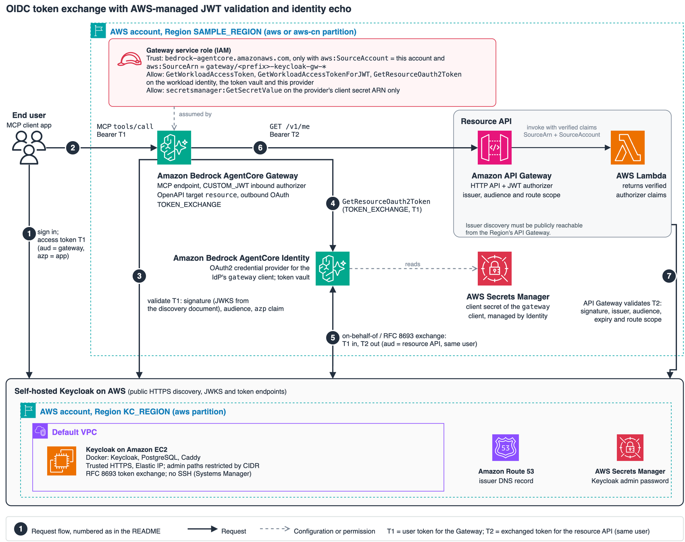

# sample-agentcore-oidc-token-exchange

[English](README.md)

演示用户身份经过 Amazon Bedrock AgentCore Gateway 和 AgentCore Identity 的 OIDC token exchange，
再由下游 API 回显。唯一 IdP 示例是**部署在 Amazon EC2 上的自托管 Keycloak**。
下游 JWT 校验由 **Amazon API Gateway HTTP API 原生 JWT authorizer** 执行，
Lambda 函数展示托管 authorizer 已验证的身份 claims。

> **免责声明：本仓库仅为示例，不用于生产。**
> 请使用隔离的测试账号和虚构身份，自行完成适用的安全、性能及可靠性验证。部署会产生 AWS 费用。

## 架构



1. 测试用户登录 Keycloak，获得 audience 为 `gateway` 的 T1。
2. 客户端携带 T1 调用 Gateway 的 MCP 工具 `resource___whoami`。
3. Gateway 托管 `CUSTOM_JWT` authorizer 根据配置检查签名、audience 和 `azp=app`。
4. Gateway 向 AgentCore Identity 请求下游 token。
5. Identity 使用 Keycloak 的 `gateway` 机密客户端完成 RFC 8693 token exchange，
   得到 audience 为 `resource-api`、scope 为 `resource.read` 的 T2。
6. Gateway 携带 T2 请求 `GET /v1/me`。
7. API Gateway 原生 JWT authorizer 校验 T2 及路由 scope；
   Lambda 将 `requestContext.authorizer.jwt.claims` 原样序列化返回。

此示例展示 token exchange 后的身份。
符合托管校验条件的身份可以看到自己的 claims；Keycloak 的 token 签发策略决定哪些身份能获得相应 token。
引入敏感业务数据之前需要单独设计访问控制。

## 前提

- Python 3.10+、AWS CLI v2、具备所需资源创建权限的 AWS 凭证。
- 应用区域支持 AgentCore Gateway/Identity、HTTP API JWT authorizer、Lambda、
  IAM、Secrets Manager 和 CloudWatch Logs。
- Route 53 托管域及未使用的公共 DNS 名；`KC_REGION` 中有默认 VPC、EC2、EBS、Elastic IP 和 SSM。
- 使用独立的 Keycloak realm；setup 添加示例所需配置，管理员负责维护 realm 中的其他用户和客户端。

Keycloak discovery、JWKS 和 token 端点必须能通过可信公共 HTTPS 被托管服务访问。
管理路径仅允许 `KC_ADMIN_CIDR`。测试使用 password grant；真实用户应用应采用 IdP 支持的
authorization-code/PKCE 流程。

## 部署

```sh
git clone https://github.com/aws-samples/sample-agentcore-oidc-token-exchange.git
cd sample-agentcore-oidc-token-exchange
pip install -r requirements.txt
export KC_HOSTNAME=keycloak.example.com
export KC_HOSTED_ZONE_ID=<your-hosted-zone-id>
export KC_ADMIN_CIDR=<your-admin-public-ip>/32
export KC_REALM=sample
export SAMPLE_REGION=us-west-2
resource-api/build.sh .build
python idp/keycloak/infra.py
python idp/keycloak/setup.py
python resource-api/deploy.py .build/resource-api.zip
python gateway/provision.py
```

先等待 Keycloak 证书就绪，从允许的管理 CIDR 运行 setup。Lambda ZIP 仅含标准库代码。
API 更新期间禁用默认端点，先配置 authorizer 并保护现有路由，再上传回显函数，
移除 `GET /v1/me` 以外的路由，最后启用端点。失败时端点可能保持禁用，修复后重跑。
脚本不支持自定义域名及手工添加的 stage/integration。

HTTP API 名为 `<prefix>-keycloak-resource-api-jwt`。部署为函数维护专用端点；
如有名为 `<prefix>-keycloak-resource-api` 的 API，会在暂停 Lambda 调用权限期间删除它。
维护过程可能中断服务并改变 URL，部署后必须重跑 `gateway/provision.py` 并更新直接客户端。

| 环境变量 | 默认值 | 作用 |
|---|---|---|
| `IDP` | `keycloak` | 唯一支持值 |
| `SAMPLE_PREFIX` | `sample-oidc` | AWS 应用资源前缀 |
| `SAMPLE_REGION` / `SAMPLE_PROFILE` | `us-west-2` / 默认凭证链 | API、Gateway、Identity 的区域与凭证 |
| `SECRETS_REGION` | `us-west-2` | 全球账号中 IdP 源凭证的 Secrets Manager 区域 |
| `SAMPLE_STATE` | `.state` | 非秘密资源 ID；其他部署使用 `.state-<suffix>` |
| `KC_HOSTNAME` / `KC_HOSTED_ZONE_ID` | 必填 | 公共域名与 Route 53 zone |
| `KC_REGION` / `KC_REALM` | `us-west-2` / `sample` | 全球 AWS 区域及独立 realm |
| `KC_INSTANCE_TYPE` / `KC_VERSION` | `t3.medium` / `26.8.1` | 实例创建时生效 |
| `KC_ADMIN_CIDR` | 自动发现的公网 IP `/32` | 创建时设置的管理访问范围 |
| `SAMPLE_GATEWAY_DEBUG` | 未设置 | `1` 返回详细错误，只用于调试 |

issuer、audience、scope 由 Keycloak adapter 的 `resource_api_config()` 提供给托管 API。
Lambda 不保存身份配置；Gateway 入口只允许 audience `gateway`。
`KC_ADMIN_CIDR`、版本和实例类型不会通过重跑 infra 更新已有实例。

### AWS 中国区域

保留通过 `SAMPLE_REGION=cn-north-1` 和对应 `SAMPLE_PROFILE` 构建 `aws-cn` ARN 的路径。
使用单独的 `SAMPLE_STATE`。Keycloak 与 IdP 源凭证仍在全球 AWS 账号，使用默认凭证链，
需要评估跨境 HTTPS 连通性及数据政策。

**HTTP API 原生 JWT authorizer 在 `cn-north-1` 和 `cn-northwest-1` 可用。**
API Gateway 创建 authorizer 时会获取 issuer 的 `/.well-known/openid-configuration`。
Keycloak 的 discovery 端点及其声明的 JWKS URI 必须能被中国区 API Gateway 通过公网和可信 HTTPS 访问。
中国区无法访问 discovery 端点的 issuer，例如不可达的 Google 端点，不能使用；
仅从操作者的机器访问成功并不足够。
服务可用不等于特定 Keycloak 部署或完整 AgentCore token-exchange 链路已经验证通过。
请在目标环境检查链路及区域依赖，再使用这一托管访问控制边界。

## 使用与检查

本地 HTTPS 测试需要 PATH 中可用的 OpenSSL，用于生成临时测试证书。

```python
import json
from lib import idp, mcp
adapter = idp.load()
with open(idp.state_file("keycloak", f"gateway-{idp.REGION}")) as state:
    gateway = json.load(state)["gatewayUrl"]
status, reply = mcp.tool(gateway, adapter.token("user-a", "gateway"), "resource___whoami", {})
```

响应是 authorizer 提供的 claims，可能包含个人信息，请勿不必要地记录。

```sh
python -m unittest discover -s tests -v
pip install ruff==0.17.1 bandit==1.9.4 pre-commit==4.5.1
ruff check .
ruff format --check .
bandit -c pyproject.toml -r .
```

离线测试检查身份回显和 AWS 配置调用；部署后的检查验证托管服务行为。
pre-commit 还需安装 git-secrets 并注册 AWS 规则。
获得部署测试授权后，可分别运行 `tests/e2e/test_resource_api.py`、
`tests/e2e/test_gateway.py`、`tests/e2e/test_identity_direct.py`。
最后一个脚本会创建测试 workload identity；使用端点前必须通过拒绝访问测试。

## 清理

```sh
python scripts/cleanup.py
python scripts/cleanup.py --execute --idp keycloak
```

`--region R` 可重复；不加 `--idp keycloak` 时仅清理所选区域的应用资源。
加上后还删除 Keycloak 实例及 realm 数据、EIP、安全组、实例角色和凭证。
DNS 清理需要原来的 `KC_HOSTNAME`、`KC_HOSTED_ZONE_ID` 和 `KC_REGION`。
Secrets Manager 无恢复窗口删除；失败后没有自动回滚。
按精确资源名与项目标签选择，不要复用它们。列表只读第一页，适用于小型 sandbox。
Gateway 管理的 workload identity 和 provider secret 预计由所属服务清理，
必须通过最终 dry run 和服务资源清单确认。其他日志和手工添加的资源不在清理范围。

## 安全、费用和许可证

见 [SECURITY.md](SECURITY.md)：直接 Lambda 调用、token 缓存、公共端点及凭证的风险。
托管 authorizer 和 IAM 权限共同构成示例的访问控制边界。
按量服务、持续运行的 EC2、EBS 和公共 IPv4 均会产生费用，见 [AWS Pricing](https://aws.amazon.com/pricing/)。
采用 [MIT-0](LICENSE)，第三方软件见 [THIRD_PARTY_LICENSES](THIRD_PARTY_LICENSES)。
